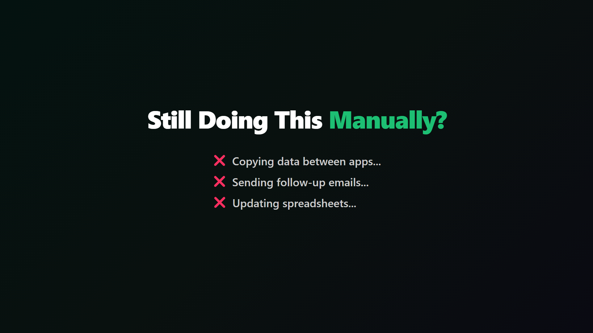
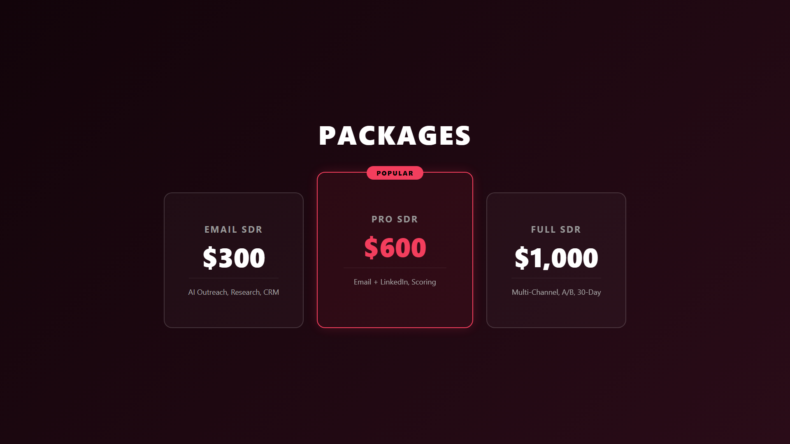

# Fiverr Gig Assets Generator

Complete toolkit for generating professional Fiverr gig images, explainer videos, and PDF sheets — all from a single data source.

## Status

Last reviewed: September 2026 · release v2026.09

**Live Profile:** [fiverr.com/agencies/skynetjoellc](https://www.fiverr.com/agencies/skynetjoellc)

---

## What's Inside

| Asset | Tool | Output |
|-------|------|--------|
| **Gig Images** (3 per gig) | `gig-images-generator.html` | Thumbnail, Packages card, How-It-Works card |
| **Explainer Videos** (38s each) | Remotion (`n8n-video/`) | 1920×1080 MP4 with background music |
| **PDF Sheets** | Built into the catalog HTML | One-page gig summary per service |

## Gigs Included (10 Services)

| # | Service | Accent |
|---|---------|--------|
| 1 | N8N & AI Workflow Automation | 🟢 Green |
| 2 | AI Voice Agent & Chatbot | 🟣 Purple |
| 3 | AI SaaS / Web App (Vibe Coding) | 🔵 Blue |
| 4 | GoHighLevel + AI Automation | 🟠 Orange |
| 5 | AI Employee / Virtual Worker | 🔴 Red |
| 6 | Full AI Business Setup (7-in-1) | 🟡 Gold |
| 7 | Custom AI Chatbot | 🟢 Teal |
| 8 | AI SDR & Sales Automation | 🔵 Indigo |
| 9 | AEO Content Engine & SEO | 🟣 Magenta |
| 10 | AI MVP & Prototype Sprint | 🟠 Coral |

---

## Quick Start

### 1. Generate Gig Images

Open `gig-images-generator.html` in your browser. Each gig shows 3 canvas-rendered images:

- **Image 1** — Minimalistic thumbnail with massive headline text + photo
- **Image 2** — 3-tier pricing card (Starter / Business / Enterprise)
- **Image 3** — How-it-works flow diagram

Click **Download PNG** on any image. Filenames are SEO-optimized (e.g., `n8n-ai-workflow-automation-thumbnail.png`).

### 2. Generate Explainer Videos

```bash
cd n8n-video
npm install

# Preview in Remotion Studio
npx remotion studio

# Render a single gig video
npx remotion render src/index.ts Gig1 out/gig-1-video.mp4

# Render all 10 videos
bash render-all.sh
```

Each video is a 38-second explainer with 7 scenes:
1. **Hook** — Pain point headline with animated text
2. **Solution** — What you get
3. **How It Works** — 3-step animated flow
4. **What I Build** — 6 deliverables grid
5. **Results** — Animated stats counters
6. **Pricing** — 3-tier package cards
7. **CTA** — Call to action with Fiverr link

#### Background Music

The videos use a procedurally generated ambient synth pad (royalty-free):

```bash
node generate-bgm.js   # Creates public/bgm.wav
```

### 3. Customize for Your Gigs

All gig data lives in `n8n-video/src/gigData.ts`. Edit the `GIGS` array to change:

- Headlines, pain points, solution text
- Pricing tiers and features
- Stats and deliverable items
- Accent colors and backgrounds

The same data drives both the image generator and the video compositions.

---

## Example Outputs

### Gig 1 — N8N Automation (Hook Scene)


### Gig 5 — AI Employee (How It Works Scene)


### Gig 8 — AI SDR (Pricing Scene)


---

## File Structure

```
fiverr-gig-assets/
├── gig-images-generator.html    # Open in browser → generate all gig images
├── n8n-video/
│   ├── src/
│   │   ├── gigData.ts           # All gig data (edit this to customize)
│   │   ├── GigVideo.tsx         # Main video composition (all 7 scenes)
│   │   ├── Root.tsx             # Registers all 10 compositions
│   │   └── index.ts             # Remotion entry point
│   ├── generate-bgm.js         # Procedural background music generator
│   ├── render-all.sh           # Batch render all 10 videos
│   ├── public/                 # Static assets (bgm.wav goes here)
│   └── out/                    # Rendered videos + preview images
└── README.md
```

## Tech Stack

- **[Remotion](https://www.remotion.dev/)** — React-based video rendering
- **HTML5 Canvas** — Gig image generation (no external dependencies)
- **Node.js** — Procedural audio generation (WAV)

## Requirements

- Node.js 18+
- npm

---

Built by [SkynetJoe LLC](https://www.fiverr.com/agencies/skynetjoellc) | [skynetjoe.com](https://www.skynetjoe.com)
